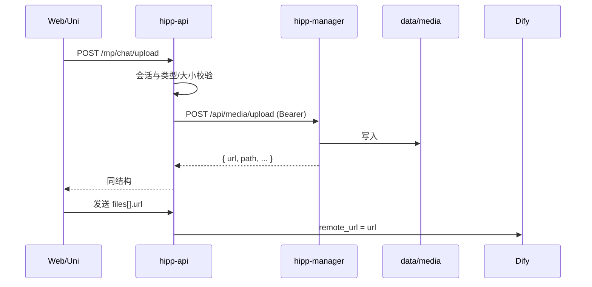

# 关联文档

| 类型 | 文档路径 |
|:---|:---|
| 原始需求 | `hipp-manager/doc/01-or/【平台】公共媒体上传与访问.md` |
| 测试设计 | `hipp-manager/doc/03-tr/04 媒体/公共媒体上传测试设计.md` |
| 关联设计 | `hipp-or/doc/02-dr/04 小程序对话/多模态附件与语音输入设计.md` |

# 功能设计

## 包与挂载

- Python 包：`hipp-manager/server/media/`（与 `manager` 并列，`PYTHONPATH=server`）。
- 应用组装：`manager.app.create_app` 注册 media 路由，并将 `settings.media_dir` 挂载为静态目录 `/media`。
- 磁盘根：默认 `data/media/`（已有）；可用环境变量覆盖（见运维）。

## 上传

`POST /api/media/upload`

| 项 | 说明 |
|:---|:---|
| 鉴权 | `Authorization: Bearer <manager_token>`（普通用户会话，同身份设计） |
| Content-Type | `multipart/form-data` |
| 字段 | `file`（必填）；`product`（必填，白名单 `mgr`/`or`/`vf`/`cert`）；`prefix`（可选，仅字母数字与 `_-/`，默认 `file`） |
| 校验 | 单文件大小 ≤ `MEDIA_MAX_BYTES`（默认 20MiB）；文件名须有扩展名；拒绝空文件 |
| 落盘相对键 | `{product}/{user_id}/{prefix}/{yyyymmdd}/{uuid}{ext}` |
| 响应 | `{ path, url, name, size, mime }`；`url` = `MEDIA_PUBLIC_BASE` + `/media/` + `path`（无尾斜杠拼接） |

调用方（如 or）可在转发前做更严的类型/会话校验；本接口不做对话业务语义。

## 访问

- `GET /media/{path}`：StaticFiles，公开读；禁止目录索引。
- 生产 Nginx：增加 `location ^~ /media/` 反代至本服务（或 alias 到同一目录）；`/api/media/` 上传须提高 `client_max_body_size`（建议 ≥20m）。

## 产品接入（or 对话）

- 保留 `POST /mp/chat/upload` 作为对话门面：会话归属、类型白名单、单图/单文档上限仍在 or。
- or 用缓存的 `manager_token` 把文件流转发至本接口；`product=or`，`prefix=chat`。
- 消息 `attachments[].url` 存本服务返回的绝对 `url`；Dify 仍走 `remote_url`。

# 配置

| 变量 | 说明 |
|:---|:---|
| `MEDIA_PUBLIC_BASE` | 公网基址，如 `https://hipp.site`；空则开发可用请求 Host 推导或 `http://127.0.0.1:9100` |
| `MEDIA_MAX_BYTES` | 单文件上限，默认 `20971520`（20MiB） |
| `MEDIA_DIR` | 可选，覆盖默认 `data/media` |

## 删除

### 用户删除

`DELETE /api/media`

| 项 | 说明 |
|:---|:---|
| 鉴权 | 用户 Bearer |
| Body JSON | `path` 与 `url` 至少其一；同时有则以 `path` 为准 |
| 归属 | 相对键须为 `{product}/{user_id}/...`，且 `user_id` 为当前用户；否则 403 |
| 结果 | 删盘；不存在也 200 `{ok:true, deleted:false}` |

### S2S 批量删除

`POST /api/s2s/media/delete`

| 项 | 说明 |
|:---|:---|
| 鉴权 | `X-Manager-Key` |
| Body | `product`（必填）；`paths` 与/或 `urls`（数组） |
| 约束 | 每条相对键须以 `{product}/` 开头；越权项跳过并记入 `skipped` |
| 响应 | `{ ok, deleted: int, skipped: int }` |

从 URL 解析相对键：取 `/media/` 之后的路径（去 query）。

### S2S 孤儿扫盘

`POST /api/s2s/media/gc`

| 项 | 说明 |
|:---|:---|
| 鉴权 | `X-Manager-Key` |
| Body | `product`（必填）；`prefix`（默认 `chat`）；`keep_urls`（数组，可空）；`min_age_hours`（默认 24，≥1） |
| 行为 | 遍历 `media_dir/{product}/*/{prefix}/**` 文件；`mtime` 早于「现在 − min_age_hours」且相对键不在 `keep_urls` 对应集合中则删盘 |
| 响应 | `{ ok, scanned, deleted, skipped_young, skipped_keep }` |

# 约束与边界

- 首期仅本地盘；不引入 oss2。
- 不提供目录列举 API；扫盘仅经 S2S gc。
- 上传失败返回明确 4xx；磁盘错误 500，文案不暴露内部路径细节。
